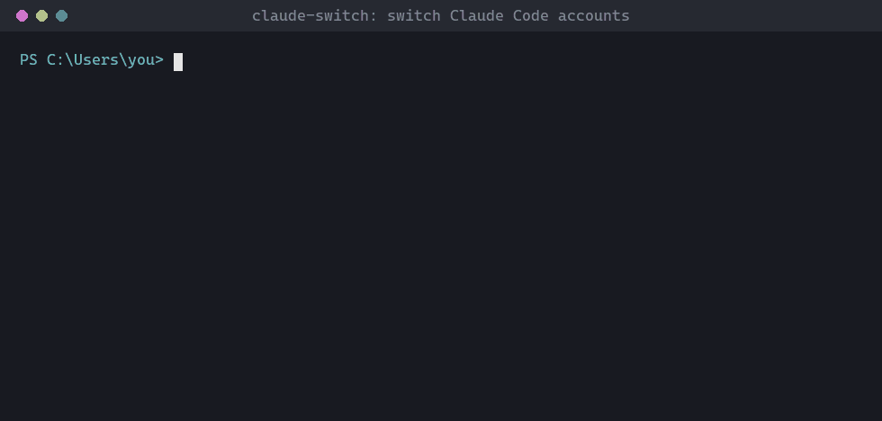

# claude-switch: multiple Claude Code accounts on Windows

**Have a work and a personal Claude account? Switch Claude Code between them in one command, without logging out.** Works with the Claude Code CLI, the Cursor extension and the VS Code extension.


```powershell
cs                  # list accounts and where each one is in use
cs cursor work      # Cursor now uses your work account (after Reload Window)
cs cursor main      # back to your personal account
```

<!-- Demo GIF goes here: record `cs cursor work` -> Reload Window -> the panel's email changes, save as docs/demo.gif, then uncomment:

-->

## Why

Claude Code signs in one account per config directory. Without a switcher, moving between a company account and a personal one means `/logout`, `/login` and a browser round-trip every time, and the editor extensions don't let you pick an account at all.

claude-switch gives each account its own directory and points Claude Code's `CLAUDE_CONFIG_DIR` environment variable at it. That variable is Claude Code's own supported mechanism; claude-switch never edits, copies or swaps credential files.

## Features

- **One-command switching** for the CLI (`cs use`, `cs run`) and the editor extensions (`cs cursor`, `cs code`).
- **No re-login:** each account signs in once and stays signed in.
- **Editor-friendly:** switching Cursor or VS Code needs only a Reload Window, not a restart.
- **Optional shared chat history:** let accounts see the same chats and project memory, while logins stay separate.
- **Shared setup:** new accounts start with your settings, `CLAUDE.md`, skills, agents, commands and memory.
- **Safe by design:** never touches credentials, backs up editor settings before changing them, and removes shared folders without deleting what they point to.
- Works from **PowerShell** and **Git Bash**. No admin rights needed.

## Quick start

```powershell
git clone https://github.com/tuankhang39/claude-switch-tool.git "$HOME\.claude-switch"
& "$HOME\.claude-switch\install.ps1"
# open a new terminal, then:
cs add work         # creates the account and opens Claude Code: run /login once
cs cursor work      # Cursor: Ctrl+Shift+P -> Developer: Reload Window
```

Full details below.

## Requirements

- Windows PowerShell 5.1 or later
- Claude Code: either the CLI, or only the VS Code / Cursor extension. If `claude` is not on your PATH, claude-switch uses the binary bundled with the extension and provides a `claude` command for you.

## Install

```powershell
git clone https://github.com/tuankhang39/claude-switch-tool.git "$HOME\.claude-switch"
cd "$HOME\.claude-switch"
.\install.ps1
```

`install.ps1` adds one line to your `$PROFILE` so `claude-switch.ps1` loads in every new terminal. It is safe to run more than once.

If PowerShell refuses to run the script, allow local scripts first:

```powershell
Set-ExecutionPolicy -Scope CurrentUser RemoteSigned
```

Restart your terminal and run `cs help`.

### Git Bash

`cs` is a PowerShell function, so Git Bash does not know it. Run this once in Git Bash to add a wrapper:

```bash
echo 'cs() { powershell -NoProfile -Command ". \"\$HOME/.claude-switch/claude-switch.ps1\"; claude-switch $*"; }' >> ~/.bashrc
source ~/.bashrc
```

Keep the `\$HOME`: it makes PowerShell use its own Windows path (`C:\Users\...`). Git Bash's `$HOME` is `/c/Users/...`, which PowerShell cannot open.

`cs use` has no effect from Git Bash, because it only changes the short-lived PowerShell process. Use `cs cursor` / `cs code` / `cs default` / `cs run` instead.

## Usage

`cs` is an alias for `claude-switch`. Commands and account names tab-complete in PowerShell.

| Command | What it does |
|---|---|
| `cs` | List accounts with their email and where each one is in use (see below) |
| `cs add <name>` | Create an account, copy shared config from `main`, and start Claude Code so you can `/login` |
| `cs use <name>` | Switch the current PowerShell terminal to that account |
| `cs run <name> [args]` | Run `claude` as that account without switching the terminal |
| `cs cursor <name>` | Switch the Cursor extension to that account, then run **Developer: Reload Window** |
| `cs code <name>` | Same for the VS Code extension |
| `cs default <name>` | Set the default account for new terminals and the VS Code extension (needs a full VS Code restart) |
| `cs sync <name>` | Re-copy settings and skills (and memory, unless history is shared) from `main` |
| `cs remove <name>` | Delete an account (asks for confirmation) |

Tags in the `cs` list:

| Tag | Meaning |
|---|---|
| `*` / `active` | The account this PowerShell terminal uses (`cs use`) |
| `default` | The user-level default (`cs default`) |
| `cursor` | The account the Cursor extension launches with (`cs cursor`) |
| `code` | The account the VS Code extension launches with (`cs code`) |

Example:

```powershell
cs add work          # first time: create the account, then /login
cs cursor work       # Cursor's extension uses work after Reload Window
cs cursor main       # back to main
cs use work          # this terminal now uses work
claude
cs run main -c       # open main and continue its most recent session
```

## Logging in

Each account logs in **once**, with `/login` after `cs add <name>`. The login is stored in that account's directory and refreshes on its own, so switching never asks you to sign in again. You only log in again if you log out, the token is revoked (for example a password change or an admin removing access), or you delete the account directory.

## Using with Cursor or VS Code

```bash
cs cursor work    # or: cs code work
```

Then in the editor: **Ctrl+Shift+P → Developer: Reload Window**. No need to close every window.

- The command sets `CLAUDE_CONFIG_DIR` in the extension's `claudeCode.environmentVariables` user setting. Only that key is rewritten; the rest of `settings.json` stays as is, other variables in the same array are kept, and the previous file is saved as `settings.json.bak`.
- The setting is user-level, so it applies to every project and window. Each window that is already open needs one Reload Window; windows opened later pick it up on their own.
- Switching to `main` removes the variable instead of pointing it at `~\.claude`, because `main` keeps its login in `~\.claude.json`, outside that folder.
- `cs default <name>` is the older way. It sets a user environment variable that VS Code reads only at startup, so you have to close **all** windows and reopen. `cs cursor` / `cs code` avoid that.

## Sharing chat history between accounts (optional)

By default every account has its own chat history. Claude Code keeps history and per-project memory in `<config dir>\projects\`, with one folder per project path. To let an account see the same history as `main`, replace its `projects` folder with a junction to `main`'s:

```powershell
# only do this when the account's projects\ holds nothing you need
Rename-Item "$HOME\.claude-accounts\work\projects" projects.bak
New-Item -ItemType Junction -Path "$HOME\.claude-accounts\work\projects" -Target "$HOME\.claude\projects"
```

After that:

- Both accounts read and write the same history and memory, for every project, including projects you open for the first time later.
- History is still grouped by the folder you open: opening `bentaus-api` shows `bentaus-api` chats, whichever account you use.
- Logins stay separate. `settings.json`, `CLAUDE.md`, `keybindings.json`, `skills\`, `agents\` and `commands\` are still per-account copies, so run `cs sync <name>` after changing them in `main`. `sync` detects the junction and skips memory.
- Delete `projects.bak` once you are sure you don't need it.

**Tokens:**

- Sharing the files costs nothing. Listing past chats only reads local files.
- Starting a new chat costs the same as always.
- Resuming an old chat sends its whole conversation as context, as any resume does. The first message after switching accounts costs more, because the prompt cache is not shared between accounts. For long chats, start a new one instead of resuming.
- Don't open the **same** chat in both accounts at the same time. Different chats in parallel are fine.

**Undo:**

```powershell
cmd /c rmdir "$HOME\.claude-accounts\work\projects"          # removes only the junction, not main's history
Rename-Item "$HOME\.claude-accounts\work\projects.bak" projects
```

Use `rmdir` (without `/s`) to remove a junction. In Windows PowerShell 5.1, `Remove-Item -Recurse` on a junction can follow it and delete the target's files, which here would be `main`'s history.

## Where accounts are stored

| Account | Directory |
|---|---|
| `main` | `~\.claude` plus `~\.claude.json`, Claude Code's defaults. claude-switch never modifies them |
| Others | `~\.claude-accounts\<name>` |

`add` and `sync` copy these from `main`: `settings.json`, `CLAUDE.md`, `keybindings.json`, `skills\`, `agents\`, `commands\`, and each project's `memory\` folder (skipped when history is shared). They **never** copy `.credentials.json`.

## Notes

- **Parallel sessions:** each terminal or editor can use a different account at the same time.
- **No automatic sync:** after an account is created, changes to settings or skills in `main` do not carry over on their own. Run `cs sync <name>` when you want them.
- **Uninstall:** remove the `claude-switch.ps1` line from `$PROFILE` (and the `cs()` line from `~/.bashrc` if you added it), run `cs cursor main`, `cs code main` and `cs default main`, then delete `~\.claude-switch`. Delete `~\.claude-accounts` only if you no longer need the extra accounts; use `cs remove <name>` for that: it unlinks junctions with `rmdir` before deleting, so `main`'s shared history is untouched. Don't delete an account folder that contains a junction with `Remove-Item -Recurse` or Explorer-style recursive tools.

## FAQ

**How do I use two Claude Code accounts on the same computer?**
Create the second one with `cs add work` and run `/login` once. From then on `cs use`, `cs run`, `cs cursor` and `cs code` pick the account, and neither account logs the other out.

**How do I switch the Claude Code account in Cursor or VS Code?**
Run `cs cursor <name>` (or `cs code <name>`), then **Developer: Reload Window**. The extension restarts with that account.

**Can both accounts share the same chat history?**
Yes, optionally. See [Sharing chat history between accounts](#sharing-chat-history-between-accounts-optional). Logins stay separate.

**Do I have to log in again every time I switch?**
No. Each account logs in once; switching only changes which config directory Claude Code reads.

**Does it change or copy my credentials?**
No. It only sets `CLAUDE_CONFIG_DIR`, the variable Claude Code supports for this. Credentials stay in each account's own directory.

**Can I use different accounts at the same time?**
Yes. Each terminal or editor can run a different account in parallel.

**Does it work on macOS or Linux?**
Not yet; it is Windows-only (PowerShell). The same idea works there with `export CLAUDE_CONFIG_DIR=...`.

**Is this for getting around usage limits?**
No. It is for keeping separate accounts apart, such as a company account and a personal one. Follow the terms of each account you use.

## License

MIT
